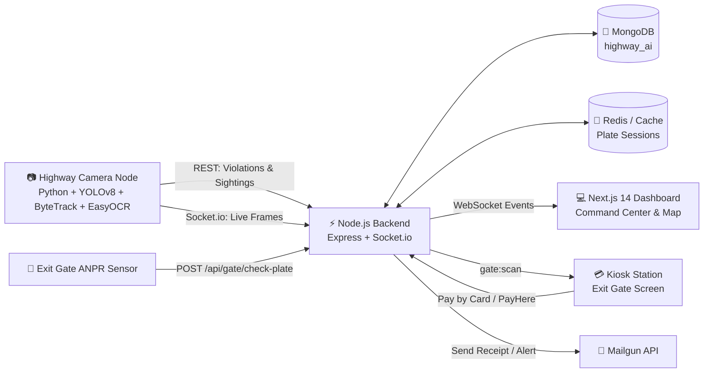

<div align="center">

# 🚦 Intelligent HighWay Transportation System (ITS) / Smart Traffic Enforcement


### Intelligent Highway Traffic Enforcement, Computer Vision & Automated Toll Clearance

Automated real-time vehicle speed measurement, custom YOLO seatbelt detection, Sri Lankan ANPR number plate recognition, and barrier-locked exit gate clearance with PayHere & Mailgun integration.


---
[](https://python.org)
[](https://ultralytics.com)
[](https://nodejs.org)
[](https://nextjs.org)
[](https://mongodb.com)
[](https://socket.io)
[](https://tailwindcss.com)
[](https://expressjs.com)
[](https://payhere.lk)

</div>

---
## 🎥 Project Demo Video

HighWay AI පද්ධතිය ක්‍රියාත්මක වන ආකාරය නරඹන්න:

👉 **[▶ Watch Live Demo](https://drive.google.com/file/d/1lZzqqR5poEBughBGj35HN_2v41kh2wqQ/view?usp=sharing)**

---
## 📌 Overview


---
**HighWay AI** transforms highway management by replacing manual radar gun checks with an automated corridor network of AI-powered vision nodes deployed along the **Southern Expressway (E01)** (e.g., Kottawa, Gelanigama, Dodangoda, Kurundugahahetekma, Pinnaduwa, Godagama, and Hambantota).

1. **Edge AI Vision Nodes**: Capture vehicles, track them using ByteTrack, calculate real instantaneous speed (km/h) across calibrated virtual lines, and measure average speed between nodes (5 km apart).
2. **Sri Lankan ANPR & Seatbelt AI**: Reads Sri Lankan vehicle plates with format cleanup (e.g., `WP CAB-1234`), while a custom-trained YOLO model inspects cabin crops to detect whether the driver is wearing a seatbelt.
3. **Real-time Central Dashboard**: Live bounding boxes, violations, and enforcement stats stream instantly via WebSockets to the Command Center.
4. **Automated Exit Gate Kiosk**: When a vehicle reaches the toll exit lane, the ANPR camera verifies its record. If unpaid traffic fines exist, the barrier locks (`🔒 BARRIER LOCKED`). Drivers pay via an integrated credit card checkout or PayHere Sandbox, receive an email receipt via Mailgun, and the barrier grants clearance (`🔓 BARRIER OPEN`).

---

## 🔐 Pre-configured Demo Accounts

The system includes JWT-based Authentication with Role-Based Access Control (RBAC). Use these pre-configured credentials to sign in to the Command Center:

| Role | Username | Password | Permissions |
| :--- | :--- | :--- | :--- |
| **ADMIN** | `admin` | `admin123` | Full access, system configurations, manual paid violation cleanup |
| **OFFICER** | `officer` | `officer123` | Real-time monitoring, live alerts, exit gate override |

---

## ✨ Key Features

| Area | Feature Description |
| :--- | :--- |
| 🎯 **Vehicle Tracking** | YOLOv8 object detection + ByteTrack multi-object tracking assigns persistent IDs to vehicles across frames. |
| ⚡ **Instantaneous Speed** | Virtual calibrated timing trap lines (Line A & B) calculate speed in km/h based on real physical road distance. |
| 📏 **Average Speed (5 km Nodes)** | Compares entry timestamp and exit timestamp across expressway camera nodes to catch speeders between cameras. |
| 🔢 **Sri Lankan ANPR** | EasyOCR engine with regional cleanup algorithms converting raw detections into standardized Sri Lankan plates (e.g., `WP CAB-1234`, `SP KQ-5678`). |
| 🪢 **Custom Seatbelt Detection** | Custom-trained YOLO model (`vision/seatbelt.pt`) detecting driver seatbelt compliance on cabin crops in real-time. |
| 🗺️ **E01 Expressway Interactive Map** | Visual interactive corridor map plotting camera sensor nodes from Kottawa (NODE-01) to Hambantota (NODE-08) with live status indicators. |
| 💳 **Card & PayHere Gateway** | Interactive Visa/Mastercard form with CVV input, and integrated PayHere Sandbox checkout with MD5 signature verification. |
| 📧 **Mailgun Email Receipts & Alerts** | Automated itemized PDF/HTML payment receipts sent upon settlement, and instant officer alert emails on declined transactions. |
| 🚧 **Smart Exit Gate Station** | Two-stage UX: Plate Scan ➔ Locked Barrier ➔ Card Payment ➔ **"Payment Successful!"** animation ➔ **"Barrier OPEN 🔓"** clearance. |
| 🗑️ **Manual Record Cleanup** | Authorized officers can manually delete settled (PAID) violations with one click to keep enforcement logs clean. |
| 🎨 **Executive Light Theme UI** | Tailored light glassmorphism interface, centered responsive navigation capsule, and zero horizontal scrolling across all devices. |

---

## 🏗️ Architecture



### Detection Pipeline (Per Vehicle)
```
Input Frame ➔ YOLOv8 Detect ➔ ByteTrack ID ➔ Virtual Lines Crossed ➔ Speed (km/h)
   ├── Lower Crop ➔ EasyOCR ➔ Sri Lankan Plate Formatter (WP CAB-1234)
   └── Upper Crop ➔ Custom YOLO Seatbelt Model (seatbelt.pt)
         └── IF (Speed > Limit OR Seatbelt == NO) ➔ POST /api/violations
```

---

## 🧰 Tech Stack

| Layer | Technologies |
| :--- | :--- |
| **Computer Vision** | Python 3.10+, Ultralytics YOLOv8, OpenCV, ByteTrack, EasyOCR, PyTorch |
| **Backend API** | Node.js, Express.js, Socket.io, Mongoose (MongoDB), JWT, Bcrypt, Multer |
| **Payment & Email** | PayHere Payment Gateway Sandbox (MD5 Signature Verification), Mailgun API |
| **Frontend Dashboard**| Next.js 14 (App Router), TypeScript, Tailwind CSS, Framer Motion, Lucide Icons |
| **Database** | MongoDB (`highway_ai` database) |

---

## 📁 Project Structure

```
Highway-Ai-System/
├── backend/                       # Express REST API & WebSocket Server
│   ├── config.js                  # E01 node configs, speed limits, fines, toll rates
│   ├── models/                    # User.js, Violation.js, VehicleSession.js, Payment.js
│   ├── services/
│   │   ├── engine.js              # Vision engine runner & process manager
│   │   ├── mailer.js              # Mailgun email receipts & failure alerts
│   │   ├── payhere.js             # PayHere Sandbox signature & verification
│   │   ├── payment.js             # Payment settlement logic & card verification
│   │   ├── plateUtils.js          # Sri Lankan number plate formatter (WP CAB-1234)
│   │   └── store.js               # In-memory / Redis plate session cache
│   ├── scripts/
│   │   ├── seed_users.js          # Pre-configured demo accounts generator
│   │   └── simulate.js            # Simulated highway traffic generator
│   └── server.js                  # Express routes, webhooks & Socket.io handlers
├── dashboard/                     # Next.js 14 Web Dashboard
│   ├── app/
│   │   ├── globals.css            # Light theme styling & zero-overflow configuration
│   │   ├── layout.tsx             # Root layout with responsive viewport
│   │   └── page.tsx               # Command Center, Map, Violations & Gate view switcher
│   ├── components/
│   │   ├── AuthModal.tsx          # JWT login modal (clean credentials input)
│   │   ├── ExitGateStation.tsx    # Exit kiosk, Visa card modal & Payment Successful flow
│   │   ├── FloatingNav.tsx        # Centered responsive navigation bar
│   │   ├── HighwayMapView.tsx     # E01 Southern Expressway interactive node map
│   │   ├── LiveCameraFeed.tsx     # Live AI camera stream with bounding boxes
│   │   ├── VideoUploader.tsx      # Video upload & batch processing component
│   │   └── ViolationsPanel.tsx    # Live violations feed with manual delete button
│   └── lib/
│       └── api.ts                 # REST client (GET, POST, DELETE) & Socket.io singleton
└── vision/                        # Python Edge Vision Engine
    ├── requirements.txt           # Python dependencies
    ├── seatbelt.pt                # Custom trained YOLO seatbelt detection weights
    ├── train_seatbelt.py          # PyTorch / YOLOv8 training script for seatbelts
    └── vision_engine.py           # Core detection, ByteTrack, speed & OCR engine
```

---

## 🚀 Getting Started

### Prerequisites
- **Node.js**: v18 or higher
- **Python**: 3.10 or higher
- **MongoDB**: Local MongoDB community service (`mongodb://localhost:27017`) or MongoDB Atlas URI

---

### 1. Setup Backend

```bash
cd backend
npm install

# Setup environment variables
cp .env.example .env
```

Your `backend/.env` file:
```env
PORT=4000
MONGO_URI=mongodb://localhost:27017/highway_ai
CLIENT_ORIGIN=http://localhost:3000
JWT_SECRET=highway-ai-jwt-super-secret-key-2026
API_KEY=highway-secret-key

# Payment Gateway Configuration
PAYMENT_PROVIDER=mock   # Options: "mock" or "payhere"
PAYHERE_MERCHANT_ID=your_merchant_id
PAYHERE_MERCHANT_SECRET=your_merchant_secret

# Mailgun Configuration
MAILGUN_API_KEY=your_mailgun_api_key
MAILGUN_DOMAIN=your_mailgun_domain
MAILGUN_FROM="HighWay AI <no-reply@highway.lk>"
OFFICER_ALERT_EMAIL=admin@highway.lk
```

Run seed script and start backend server:
```bash
# Seed admin and officer demo accounts
node scripts/seed_users.js

# Start server with hot-reload
npm run dev
# Backend running on http://localhost:4000
```

---

### 2. Setup Dashboard

```bash
cd ../dashboard
npm install
npm run dev
# Dashboard running on http://localhost:3000
```

---

### 3. Setup Edge Vision Engine

```bash
cd ../vision
python3 -m venv venv
source venv/bin/activate       # Windows: venv\Scripts\activate
pip install -r requirements.txt
```

You can now run detection on any sample video:
```bash
python vision_engine.py --source /path/to/highway_traffic.mp4 --node-id NODE-01 --speed-limit 100 --seatbelt-model seatbelt.pt --show
```
*Alternatively, use the **Upload Video** button directly on the dashboard Command Center!*

---

### 4. Test Without a Camera (Simulation Mode)

Generate realistic simulated vehicle traffic along the Southern Expressway E01:
```bash
cd backend
npm run simulate
```

1. Open `http://localhost:3000` in your browser.
2. Click **Sign In** and log in with `admin` / `admin123`.
3. Switch to the **Exit Gate Kiosk** tab.
4. Enter or scan any detected plate (e.g., `WP CAB-1234`).
5. Notice the barrier is `🔒 LOCKED` with itemized toll and fines.
6. Click **Pay by Card**, enter card details, and submit.
7. Watch the **"Payment Successful!"** animation trigger, followed by the barrier unlocking to `🔓 BARRIER OPEN`!
8. Go to the **Violations** tab and use the `✕` button to manually delete the paid record.

---

## 💰 Fines & Toll Schedule (E01 Expressway)

Configurable in `backend/config.js`:

| Violation / Fee | Rate (LKR) | Description |
| :--- | :--- | :--- |
| **Speeding (100 - 120 km/h)** | LKR 5,000 | Speeding above 100 km/h highway speed limit |
| **Speeding (120 - 140 km/h)** | LKR 10,000 | Dangerous speeding tier 2 |
| **Speeding (> 140 km/h)** | LKR 20,000 | Severe reckless driving |
| **Seatbelt Violation** | LKR 2,000 | Driver not wearing seatbelt |
| **Highway Toll Rate** | LKR 25 / km | Distance from entry interchange node to exit |

*Duplicate suppression prevents registering multiple identical violations for the same vehicle within 5 minutes.*

---

## 🔌 API Reference

### Authentication & Users
- `POST /api/auth/login` — Sign in with username and password (returns JWT & role)
- `GET /api/auth/me` — Verify active token and retrieve user profile

### Traffic & Enforcement
- `POST /api/violations` — Edge camera node violation report (Protected by `x-api-key`)
- `GET /api/violations` — Fetch recent violations (supports `?status=PAID|UNPAID`)
- `DELETE /api/violations/:id` — Delete a paid violation manually
- `POST /api/sightings` — Record vehicle sighting for average speed calculation
- `GET /api/stats` — Summary of today's violations, unpaid fines, and total collected revenue

### Exit Gate & Payments
- `POST /api/gate/check-plate` — Check vehicle status at exit barrier (`LOCKED` or `OPEN`)
- `GET /api/kiosk/bill/:plate` — Get itemized toll breakdown + pending fines
- `POST /api/kiosk/pay` — Settle via Card (with number/cvv) or Cash and trigger gate unlock
- `POST /api/kiosk/payhere/init` — Generate PayHere Sandbox checkout parameters & MD5 signature
- `POST /api/payhere/notify` — PayHere IPN webhook callback for server-to-server confirmation

### Vision Engine Control
- `POST /api/engine/upload` — Upload video file and launch edge vision engine
- `POST /api/engine/stop` — Terminate running vision engine process
- `GET /api/engine/status` — Get engine execution status and logs

---

## 🗺️ Roadmap & Completed Milestones

- [x] Train and integrate custom YOLO seatbelt detection model (`vision/seatbelt.pt`)
- [x] Sri Lankan vehicle number plate formatting and OCR cleanup (`WP CAB-1234`)
- [x] Real payment gateway (PayHere Sandbox checkout) + Mailgun email receipts
- [x] JWT Authentication & Role-Based Access Control (`ADMIN` & `OFFICER`)
- [x] Interactive E01 Southern Expressway camera node corridor map
- [x] Manual violation record cleanup button for settled fines
- [x] Executive light theme UI with centered responsive navigation capsule
- [x] Zero horizontal scrolling & cross-device responsive layout
- [ ] Docker Compose configuration for one-command containerized deployment

---
## 👤 Author

**Dulana Chathurma**  
Undergraduate Software Engineer, University of Kelaniya  
- **GitHub**: [@dulanachathurma](https://github.com/dulanachathurma)
- **LinkedIn**: [Dulana Chathurma](https://www.linkedin.com/)

---

## 📄 License

This project is licensed under the **MIT License**.

<div align="center">
⭐ If you found this project helpful, please consider giving it a star on GitHub! ⭐
</div>
