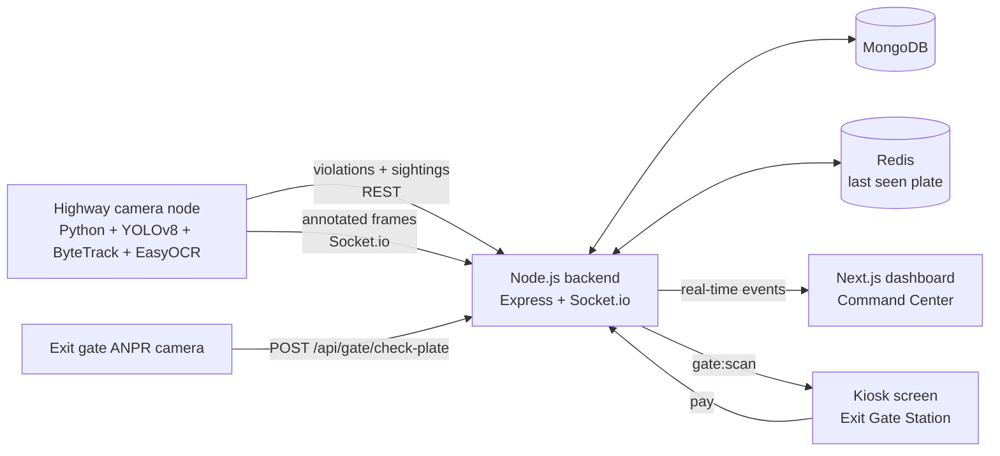

<div align="center">

# 🚦 HighWay AI

### Automated highway speed & seatbelt enforcement with Computer Vision

Cameras detect speeding and seatbelt violations in real time.
The exit gate stays **locked until the fine is paid**.


</div>

---

## 📌 Overview

**HighWay AI** replaces manual police radar checks with an automated network of AI cameras placed along a highway (about 5 km apart).

1. **Edge AI cameras** detect vehicles, measure their speed, read number plates and check seatbelt usage.
2. **Violations are streamed in real time** (WebSockets) to a command-center dashboard at the interchange office.
3. At the **exit toll gate**, the plate is scanned again. If the vehicle has unpaid fines, the barrier stays **locked** until the fine is paid at a kiosk.

> ⚠️ This is a working **prototype** built for learning and portfolio purposes, not a certified enforcement product. See [Limitations](#-limitations).

<!-- Add your screenshots here -->
<!--
<p align="center">
  
  
</p>
-->

## ✨ Features

| Area | What it does |
|---|---|
| 🎯 **Vehicle tracking** | YOLOv8 detection + ByteTrack gives every vehicle a stable ID |
| ⚡ **Speed measurement** | Time taken between two calibrated lines on the road → km/h |
| 📏 **Average speed (5 km nodes)** | Compares the time a plate is seen at two camera nodes to catch speeding between cameras |
| 🔢 **Plate recognition** | EasyOCR on the vehicle crop |
| 🪢 **Seatbelt check** | Custom YOLO model (`seatbelt` / `no_seatbelt`), with a demo mode for testing |
| 🖥️ **Live bounding boxes** | Cyan boxes with `ID \| Speed \| Seatbelt` overlay, streamed to the dashboard |
| 🚨 **Real-time alerts** | Socket.io pushes violations and gate alerts instantly |
| 🚧 **Exit gate automation** | `LOCKED` when fines are unpaid, `OPEN` when cleared |
| 💳 **Kiosk billing** | Itemized toll + fines, "Pay & Unlock Gate" |
| 📤 **Video upload** | Upload a video in the dashboard and watch the detection live |
| 🎨 **Modern UI** | Dark glassmorphism design with a floating capsule navbar |

## 🏗️ Architecture



### Detection pipeline (per vehicle)

```
frame → YOLOv8 detect → ByteTrack ID → crossed line A/B? → speed (km/h)
                                    → plate OCR (lower part of vehicle)
                                    → seatbelt model (upper part of vehicle)
        speed > limit  OR  seatbelt == NO  →  POST /api/violations
```

**Speed formula:** `speed = distance between lines (m) ÷ time between crossings (s) × 3.6`

## 🧰 Tech Stack

| Layer | Technology |
|---|---|
| Computer Vision | Python, OpenCV, Ultralytics YOLOv8, ByteTrack, EasyOCR |
| Backend | Node.js, Express, Socket.io, Mongoose, ioredis, Multer |
| Database | MongoDB (Atlas or local), Redis (optional) |
| Frontend | Next.js 14 (App Router), TypeScript, Tailwind CSS, Framer Motion |

## 📁 Project Structure

```
Highway-Ai-System/
├── vision/                     # Edge AI engine
│   ├── vision_engine.py
│   └── requirements.txt
├── backend/                    # REST API + WebSockets
│   ├── server.js
│   ├── config.js               # limits, fines, toll, camera nodes
│   ├── models/                 # Violation, VehicleSession
│   ├── services/               # store (Redis), payment, engine runner
│   └── scripts/simulate.js     # fake traffic for testing
└── dashboard/                  # Next.js admin dashboard + kiosk
    ├── app/
    ├── components/             # LiveCameraFeed, ViolationsPanel,
    │                           # ExitGateStation, VideoUploader, FloatingNav
    └── lib/
```

## 🚀 Getting Started

### Prerequisites
- Node.js 18+
- Python 3.10+
- MongoDB (local, or a free [MongoDB Atlas](https://www.mongodb.com/atlas) cluster)
- Redis (optional – the backend falls back to memory)

### 1. Clone
```bash
git clone https://github.com/dulanachathurma/Highway-Ai-System.git
cd Highway-Ai-System
```

### 2. Backend
```bash
cd backend
cp .env.example .env        # then edit MONGO_URI (and remove REDIS_URL if you have no Redis)
npm install
npm run dev                 # http://localhost:4000
```

### 3. Dashboard
```bash
cd dashboard
cp .env.local.example .env.local
npm install
npm run dev                 # http://localhost:3000
```

### 4. Vision engine
```bash
cd vision
python3 -m venv venv
source venv/bin/activate    # Windows: venv\Scripts\activate
pip install -r requirements.txt
```

You can now either:

- **Upload a video** from the dashboard (Command Center → *Upload Video*), or
- run it manually:
  ```bash
  python vision_engine.py --source path/to/highway.mp4 --demo --show
  ```

### 5. Try it without any camera
```bash
cd backend
npm run simulate
```
Then open the **Exit Gate** tab, scan `CAB1234` (🔒 locked), pay, and watch it turn 🔓 open.

## ⚙️ Vision Engine Options

| Flag | Description | Default |
|---|---|---|
| `--source` | Video file, RTSP URL or camera index | `0` |
| `--node-id` | Camera node name (see `config.js`) | `NODE-01` |
| `--distance-m` | **Real** distance between the two lines (metres) | `20` |
| `--line-a`, `--line-b` | Line positions (fraction of frame height) | `0.45`, `0.75` |
| `--speed-limit` | Speed limit in km/h | `100` |
| `--demo` | Fake plates + random seatbelt result (for testing) | off |
| `--seatbelt-model` | Path to a custom seatbelt YOLO model | `seatbelt.pt` |
| `--show` | Open an OpenCV preview window | off |
| `--fast` | Process as fast as possible (no real-time pacing) | off |

> 📐 **Calibration matters.** Measure the real distance between the two lines on your road and pass it with `--distance-m`, otherwise the speed will be wrong.

## 🪢 Seatbelt Model

COCO-trained YOLO has no seatbelt class. Train your own YOLOv8 model with two classes, `seatbelt` and `no_seatbelt`, and save it as `vision/seatbelt.pt`. Public datasets are available on Roboflow. Until then, use `--demo`.

## 💰 Fines & Toll (configurable in `backend/config.js`)

| Violation | Fine (LKR) |
|---|---|
| Speed over 100 km/h | 5,000 |
| Speed over 120 km/h | 10,000 |
| Speed over 140 km/h | 20,000 |
| No seatbelt | 2,000 |

Toll = distance from entry node to the exit node × `TOLL_PER_KM`. Duplicate violations (same plate + same type within 5 minutes) are ignored.

## 🔌 API Reference

| Method | Endpoint | Description |
|---|---|---|
| `POST` | `/api/violations` | Camera node reports a violation (needs `x-api-key`) |
| `POST` | `/api/sightings` | Camera node reports a plate sighting (session + average speed) |
| `POST` | `/api/gate/check-plate` | Exit gate check → `LOCKED` or `OPEN` |
| `GET` | `/api/kiosk/bill/:plate` | Itemized toll + fines |
| `POST` | `/api/kiosk/pay` | Pay (`CASH` / `CARD`) and unlock the gate |
| `GET` | `/api/violations` | Latest violations |
| `GET` | `/api/stats` | Today's count, unpaid count, revenue |
| `POST` | `/api/engine/upload` | Upload a video and start the vision engine |
| `POST` | `/api/engine/stop` | Stop the running engine |
| `GET` | `/api/engine/status` | Engine state |
| `GET` | `/api/health` | Health check |

**Socket.io events:** `camera:frame`, `violation:new`, `officer:alert`, `gate:scan`, `payment:success`, `payment:failed`, `engine:status`, `engine:log`

### Example
```bash
curl -X POST http://localhost:4000/api/gate/check-plate \
  -H "Content-Type: application/json" \
  -d '{"plate":"CAB1234"}'
# → { "plate": "CAB1234", "status": "LOCKED", "unpaid_total": 5000, "violations": 1 }
```

## ⚠️ Limitations

- Seatbelt detection needs a custom-trained model (demo mode is simulated).
- Speed accuracy depends on correct line calibration and camera angle.
- Plate OCR quality depends on video resolution and lighting.
- Payment is currently a **mock** (`backend/services/payment.js`).
- Real deployment would require legal approval, data-protection measures and secure evidence storage.

## 🗺️ Roadmap

- [ ] Train and ship a seatbelt detection model
- [ ] Sri Lankan plate format cleanup for OCR
- [ ] Real payment gateway (PayHere sandbox) + email alerts on payment failure
- [ ] Admin login with role-based access (JWT)
- [ ] Highway map view showing camera nodes
- [ ] Docker Compose for one-command setup

## 👤 Author

**Dulana Chathurma**
Undergraduate Software Engineer, University of Kelaniya

[GitHub](https://github.com/dulanachathurma) · [Medium](https://medium.com/@dulanachathurma99) · [LinkedIn](https://www.linkedin.com/in/dulana-chathurma/)

## 📄 License

Released under the [MIT License](LICENSE). Add a `LICENSE` file to your repo (GitHub can create one for you when you add a new file named `LICENSE`).

---

<div align="center">

If this project helped you, consider giving it a ⭐

</div>
